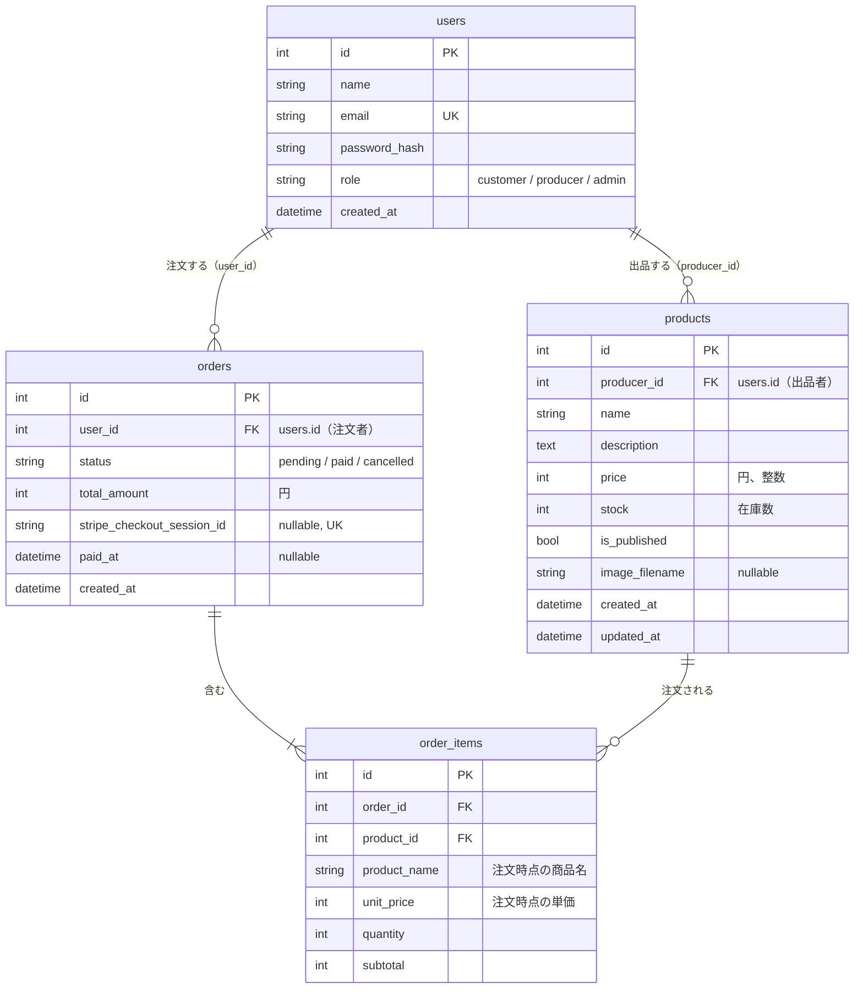

# データベース設計

ユーザーストーリー（[user-stories.md](user-stories.md)）と画面一覧（[screens.md](screens.md)）を実現するためのテーブル。テーブル名とカラム名は参考解答（`docs/spec/03_database.md`）と `marche/models.py` の `User` にそろえている。

## ER 図



## テーブル定義

### users（作成済み）

| カラム | 型 | 制約 | 説明 |
|-|-|-|-|
| id | Integer | PK | |
| name | String(50) | not null | 表示名。生産者は農園名・屋号 |
| email | String(255) | not null, unique | 小文字にそろえて保存する |
| password_hash | String(255) | not null | `generate_password_hash` の結果。平文は保存しない |
| role | String(20) | not null, default `customer` | `customer` / `producer` / `admin`（Python 側は `Role` の StrEnum） |
| created_at | DateTime | not null | 日本時間 |

### products

| カラム | 型 | 制約 | 説明 |
|-|-|-|-|
| id | Integer | PK | |
| producer_id | Integer | not null, FK `users.id`（restrict）, index | 出品した生産者 |
| name | String(50) | not null | 「ほうれん草 1束」のように量も入れる |
| description | Text | not null, default `""` | 紹介文（2,000字まで。フォームで確認） |
| price | Integer | not null | 円、税込み。50〜100,000 |
| stock | Integer | not null, default 0 | いまある数。0〜999。支払いが確定したときに減らす |
| is_published | Boolean | not null, default false | 公開中か |
| image_filename | String(100) | nullable | `static/uploads/` の中のファイル名（UUID + 拡張子）。写真がなければ null |
| created_at | DateTime | not null | |
| updated_at | DateTime | not null | 更新のたびに変わる（`onupdate=now_jst`） |

### orders

| カラム | 型 | 制約 | 説明 |
|-|-|-|-|
| id | Integer | PK | 注文番号として画面に出す |
| user_id | Integer | not null, FK `users.id`（restrict）, index | 注文した人 |
| status | String(20) | not null, default `pending` | `pending`（支払い待ち）/ `paid`（支払い済み）/ `cancelled`（キャンセル）。Python 側は `OrderStatus` の StrEnum |
| total_amount | Integer | not null | 合計金額（円）。サーバーで明細から計算する |
| stripe_checkout_session_id | String(255) | nullable, unique | Checkout Session の ID。注文を作った直後はまだ無いので nullable。unique でも null は複数あってよい（SQLite・MySQL とも） |
| paid_at | DateTime | nullable | 支払いが確定した日時 |
| created_at | DateTime | not null | 在庫の押さえ（35分）の起点 |

### order_items

| カラム | 型 | 制約 | 説明 |
|-|-|-|-|
| id | Integer | PK | |
| order_id | Integer | not null, FK `orders.id`（cascade）, index | |
| product_id | Integer | not null, FK `products.id`（restrict）, index | |
| product_name | String(50) | not null | 注文時点の商品名 |
| unit_price | Integer | not null | 注文時点の単価 |
| quantity | Integer | not null | 1〜10 |
| subtotal | Integer | not null | `unit_price × quantity`。サーバーで計算する |

## 外部キーの削除時の動き

| 関係 | 削除時 | 理由 |
|-|-|-|
| orders → order_items | cascade | 明細は注文の一部なので、注文と一緒に消える。SQLAlchemy 側も `cascade="all, delete-orphan"` にする |
| products → order_items | restrict | 注文された商品が消えると、注文の記録が壊れる。注文がある商品は削除させず、非公開にしてもらう |
| users → products | restrict | コアではユーザーを削除しない。消すと商品の出品者が分からなくなる |
| users → orders | restrict | 注文の記録（誰が買ったか）を残すため |

SQLite は、設定しないと外部キーの制約を確かめない。restrict が効くのは本番の MySQL だけなので、「注文がある商品は削除できない」はビューでも確かめる。開発・テスト・本番で同じ動きと同じメッセージにするため。`PRAGMA foreign_keys` は使わない（CLAUDE.md の決まり）。

## 在庫の方式

### 方式: 支払いが確定したときに `stock` を減らす

- `products.stock` は「いまある数」。生産者は収穫したら、いまの数に書き換えるだけでよい
- 注文を作った時点（支払い待ち）では `stock` を減らさない。支払いが確定したとき（Webhook か支払い完了ページ）に、明細の数量だけ減らす
- 確定の処理は Webhook と完了ページの両方から走りうる。二重に減らさないように、「`status` が `pending` のときだけ `paid` に更新する」条件付き更新をして、更新できたときだけ `stock` を減らす

ほかの方式との比較:

| 方式 | 中身 | 利点 | 欠点 |
|-|-|-|-|
| A. 毎回計算 | `stock` は「入荷した総数」。総数から支払い済みと支払い待ちを引く | 減らす処理が要らない。二重に減る心配がない | 生産者が「これまでの入荷の総数」を入れないといけない。補充のたびに計算が要る |
| B. 支払い確定時に減らす（採用） | `stock` は「いまある数」。支払い確定で減らす | 生産者の感覚と同じ。毎日収穫して数を書き換える産直品に合う | 確定の処理が二重に走ると二重に減る → 条件付き更新で防ぐ |

### いま買える数の計算

```text
いま買える数 = products.stock − （支払い待ちで、作成から35分以内の注文の、その商品の数量の合計）
```

- 支払い待ちも引く。引かないと、Aさんが Stripe の画面でカード番号を入れている間に、Bさんが最後の1個を買えてしまう
- 35分を過ぎた支払い待ちは数えない。Checkout Session の有効期限を31分にするので、期限が切れた決済ページではもう支払えない。決済ページを閉じたまま放置した人の分が、いつまでも在庫を押さえないようにするため
- 計算結果が0未満なら0とする
- 使う場所: 一覧・詳細の在庫表示（0なら「売り切れ」）、数量のセレクトの上限（1〜min(10, いま買える数)）、カートから注文を作るときの在庫の確認
- 計算は `marche/services/inventory.py` の `available_stock(product)` に置く
- SQL は SQLAlchemy の `select()` と `func.sum()` で書く。35分前の時刻は Python で `now_jst() - timedelta(minutes=35)` と計算して渡す。SQLite 専用の日付関数（`strftime` など）は使わない

```python
cutoff = now_jst() - timedelta(minutes=35)
reserved = db.session.scalar(
    select(func.coalesce(func.sum(OrderItem.quantity), 0))
    .join(Order)
    .where(
        OrderItem.product_id == product.id,
        Order.status == OrderStatus.PENDING,
        Order.created_at >= cutoff,
    )
)
return max(product.stock - reserved, 0)
```

### この方式で残る問題

- 2人が同時に最後の1個を注文すると、両方の注文が通ることがある（確認してから注文を作るまでに隙間がある）。支払い確定時に `stock` が足りなければ0で止めるが、片方は「売れたのに在庫がない」状態になる。対策（行ロック、条件付きの減算、在庫不足なら返金）は拡張 E1 で扱う
- 一覧では商品ごとに集計の SQL が走る（8商品なら8回）。1回にまとめるのは拡張 E16

## 補足

- 本番は MySQL なので、文字列には全て長さを付ける（`String(50)` など）
- 過去の注文が変わらないのは、注文時に `product_name` と `unit_price` を明細に写して保存するため。その後も商品の価格と名前は変えられる
- 参考解答にある `stripe_payment_intent_id` は返金（拡張 E2）用なので、コアでは持たない
- 1回の注文に複数の生産者の商品が入ることがある。生産者ごとの売上は、`order_items` を `products.producer_id` で絞り、`orders.status = paid` のものだけを集計する
